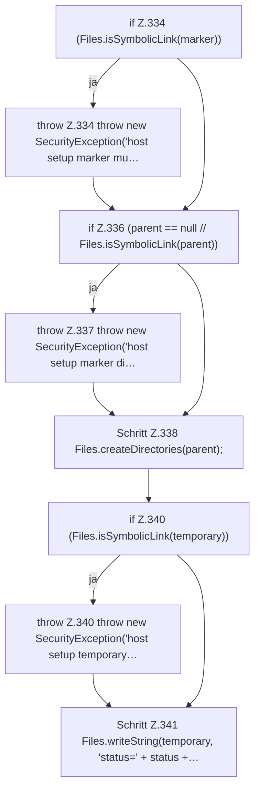

[[00 Start]] › [[Host-Betrieb]] › [[Host-Ersteinrichtung]] › [[HostFirstSetup]] › [[HostFirstSetup.Teil3]] › [[HostFirstSetup.writeMarker(Path,String,String,int,String)]] › [[HostFirstSetup.writeMarker(Path,String,String,int,String).Teil1]]

# HostFirstSetup.writeMarker(Path,String,String,int,String).Teil1



```knoten
if Z.334 (Files.isSymbolicLink(marker))
  Zeile 334: prüft `(Files.isSymbolicLink(marker))`.
throw Z.334 throw new SecurityException('host setup marker mu…
  Zeile 334: Abbruch `throw new SecurityException('host setup marker mu…`.
if Z.336 (parent == null // Files.isSymbolicLink(parent))
  Zeile 336: prüft `(parent == null // Files.isSymbolicLink(parent))`.
throw Z.337 throw new SecurityException('host setup marker di…
  Zeile 337: Abbruch `throw new SecurityException('host setup marker di…`.
Schritt Z.338 Files.createDirectories(parent);
  Zeile 338: Dateioperation. `Files.createDirectories(parent);`
if Z.340 (Files.isSymbolicLink(temporary))
  Zeile 340: prüft `(Files.isSymbolicLink(temporary))`.
throw Z.340 throw new SecurityException('host setup temporary…
  Zeile 340: Abbruch `throw new SecurityException('host setup temporary…`.
Schritt Z.341 Files.writeString(temporary, 'status=' + status +…
  Zeile 341: schreibt Text in eine Datei. `Files.writeString(temporary, 'status=' + status +…`
```

- Fortsetzung von `HostFirstSetup.writeMarker(Path,String,String,int,String)`, Quellreihenfolge.
