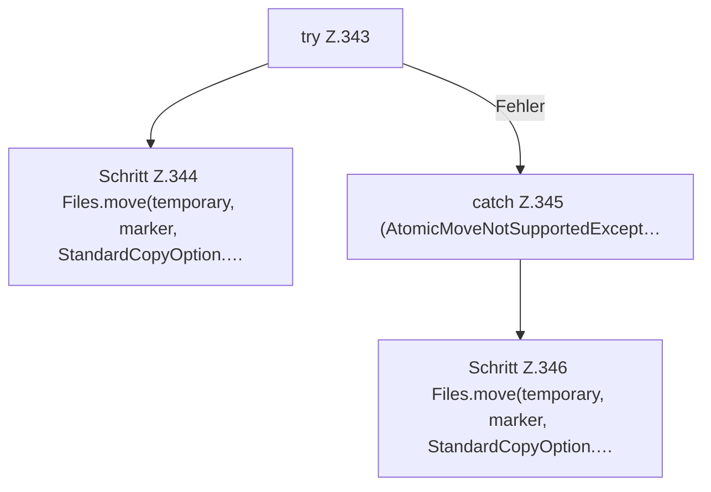

[[00 Start]] › [[Host-Betrieb]] › [[Host-Ersteinrichtung]] › [[HostFirstSetup]] › [[HostFirstSetup.Teil3]] › [[HostFirstSetup.writeMarker(Path,String,String,int,String)]] › [[HostFirstSetup.writeMarker(Path,String,String,int,String).Teil2]]

# HostFirstSetup.writeMarker(Path,String,String,int,String).Teil2



```knoten
try Z.343
  Zeile 343: Versuch. Der Fehlerpfad geht in catch.
Schritt Z.344 Files.move(temporary, marker, StandardCopyOption.…
  Zeile 344: Dateioperation. `Files.move(temporary, marker, StandardCopyOption.…`
catch Z.345 (AtomicMoveNotSupportedExcept…
  Zeile 345: fängt (AtomicMoveNotSupportedExcept….
Schritt Z.346 Files.move(temporary, marker, StandardCopyOption.…
  Zeile 346: Dateioperation. `Files.move(temporary, marker, StandardCopyOption.…`
```

- Fortsetzung von `HostFirstSetup.writeMarker(Path,String,String,int,String)`, Quellreihenfolge.
