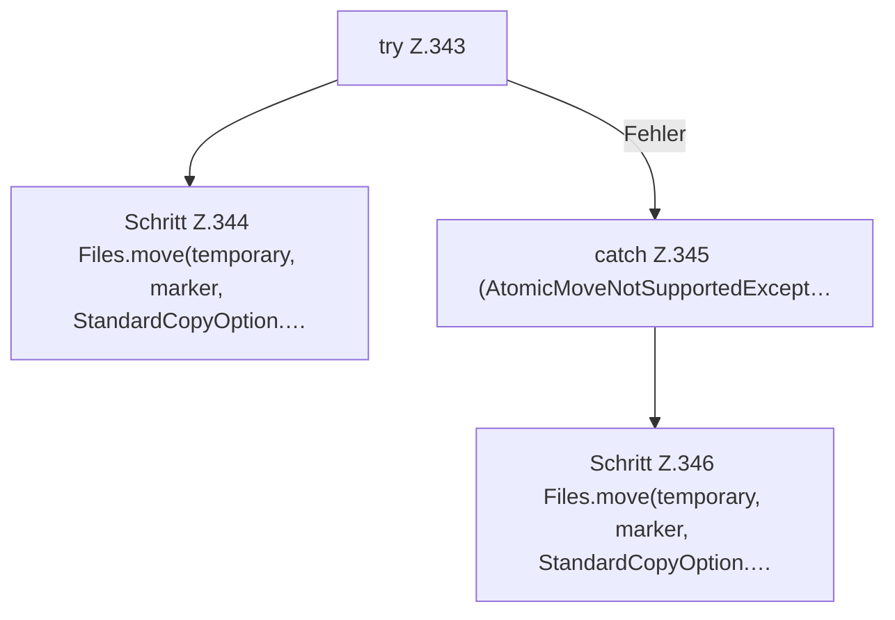

[[00 Start]] › [[Host-Betrieb]] › [[Host-Ersteinrichtung]] › [[HostFirstSetup]] › [[HostFirstSetup.Teil3]] › [[HostFirstSetup.writeMarker(Path,String,String,int,String)]] › [[HostFirstSetup.writeMarker(Path,String,String,int,String).Teil2]]

# HostFirstSetup.writeMarker(Path,String,String,int,String).Teil2

- Fortsetzung von `HostFirstSetup.writeMarker(Path,String,String,int,String)`, Quellreihenfolge.
