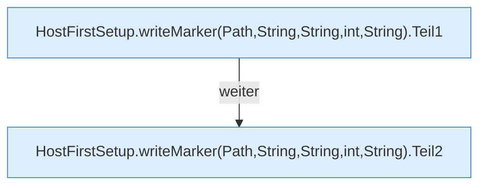

[[00 Start]] › [[Host-Betrieb]] › [[Host-Ersteinrichtung]] › [[HostFirstSetup]] › [[HostFirstSetup.Teil3]] › [[HostFirstSetup.writeMarker(Path,String,String,int,String)]]

# HostFirstSetup.writeMarker(Path,String,String,int,String)

`HostFirstSetup.writeMarker(Path marker, String status, String worldName, int disabledPluginCount, String previousWorlds)` [src/main/java/de/aichele/childlauncher/HostFirstSetup.java:333–348](https://github.com/Sciddie/minecraft-serverhoster-plugin/blob/95b02b953b0b4c23673e900e021a7c3c844aa37d/src/main/java/de/aichele/childlauncher/HostFirstSetup.java#L333-L348)



```knoten
HostFirstSetup.writeMarker(Path,String,String,int,String).Teil1
  Abschnitt 1 dieses Ablaufs, in Quellreihenfolge.
HostFirstSetup.writeMarker(Path,String,String,int,String).Teil2
  Abschnitt 2 dieses Ablaufs, in Quellreihenfolge.
```

- `writeMarker` in `src/main/java/de/aichele/childlauncher/HostFirstSetup.java`
