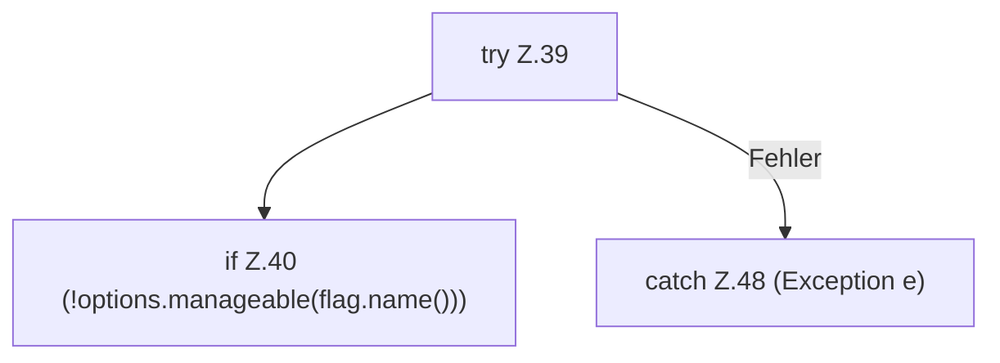

[[00 Start]] › [[Host-Betrieb]] › [[Host-Minimieren]] › [[HostHeapTune]] › [[HostHeapTune.apply]] › [[HostHeapTune.apply.Z34.Z39]]

# HostHeapTune.apply.Z34.Z39



```knoten
try Z.39
  Zeile 39: Versuch. Der Fehlerpfad geht in catch.
if Z.40 (!options.manageable(flag.name()))
  Zeile 40: prüft `(!options.manageable(flag.name()))`.
catch Z.48 (Exception e)
  Zeile 48: fängt (Exception e).
```

> [!knoten]- Was die Blöcke tun
> - **try Z.39**: Zeile 39: Versuch. Der Fehlerpfad geht in catch.
> - **if Z.40 (!options.manageable(flag.name()))**: Zeile 40: prüft `(!options.manageable(flag.name()))`.
> - **catch Z.48 (Exception e)**: Zeile 48: fängt (Exception e).

- Der Ablauf geht in [[Glossar#Zeile|Zeile]] 39 weiter. Eine Ebene tiefer steht er genauer.
- Fortsetzung von `HostHeapTune.apply.Z34`.
