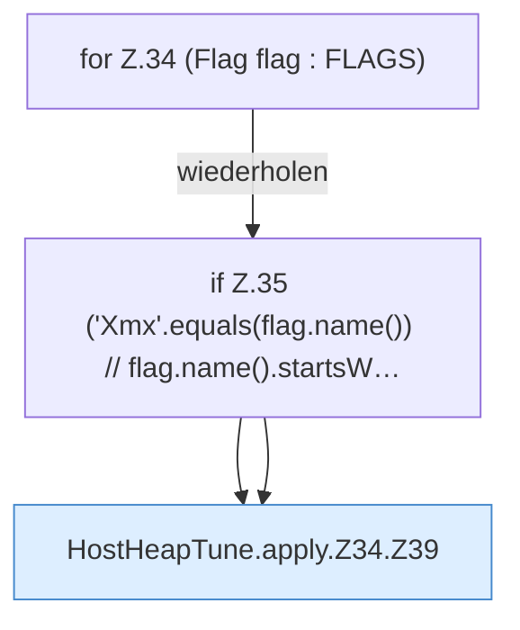

[[00 Start]] › [[Host-Betrieb]] › [[Host-Minimieren]] › [[HostHeapTune]] › [[HostHeapTune.apply]] › [[HostHeapTune.apply.Z34]]

# HostHeapTune.apply.Z34

- Fortsetzung von `HostHeapTune.apply`, Quellreihenfolge.
