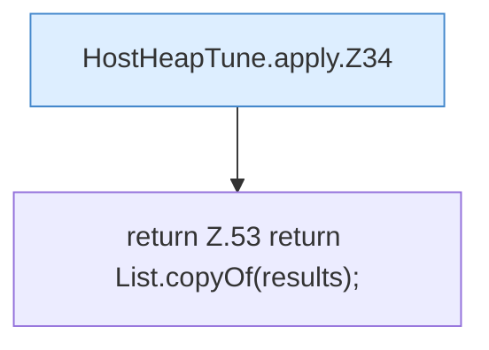

[[00 Start]] › [[Host-Betrieb]] › [[Host-Minimieren]] › [[HostHeapTune]] › [[HostHeapTune.apply]]

# HostHeapTune.apply

`HostHeapTune.apply(Options options)` [src/main/java/de/aichele/childlauncher/HostHeapTune.java:32–54](https://github.com/Sciddie/minecraft-serverhoster-plugin/blob/95b02b953b0b4c23673e900e021a7c3c844aa37d/src/main/java/de/aichele/childlauncher/HostHeapTune.java#L32-L54)



```knoten
HostHeapTune.apply.Z34
  Fortsetzung des Ablaufs ab Zeile 34.
return Z.53 return List.copyOf(results);
  Zeile 53: Rückgabe `return List.copyOf(results);`.
```

- `apply` in `src/main/java/de/aichele/childlauncher/HostHeapTune.java`
