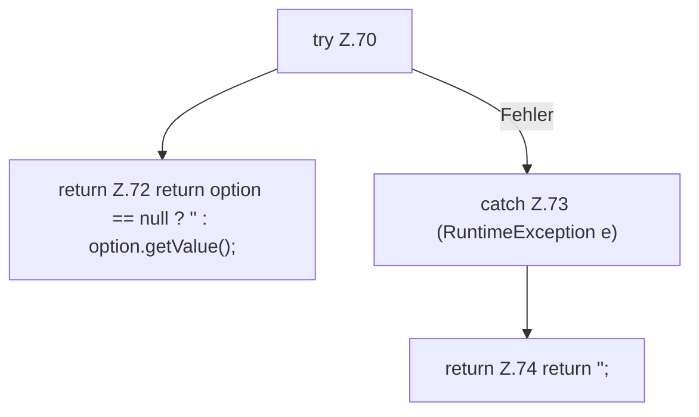

[[00 Start]] › [[Host-Betrieb]] › [[Host-Minimieren]] › [[HostHeapTune]] › [[HostHeapTune.hotspot]] › [[HostHeapTune.hotspot.get]]

# HostHeapTune.hotspot.get

`HostHeapTune.get(String name)` [src/main/java/de/aichele/childlauncher/HostHeapTune.java:69–76](https://github.com/Sciddie/minecraft-serverhoster-plugin/blob/95b02b953b0b4c23673e900e021a7c3c844aa37d/src/main/java/de/aichele/childlauncher/HostHeapTune.java#L69-L76)

- `get` in `src/main/java/de/aichele/childlauncher/HostHeapTune.java`
