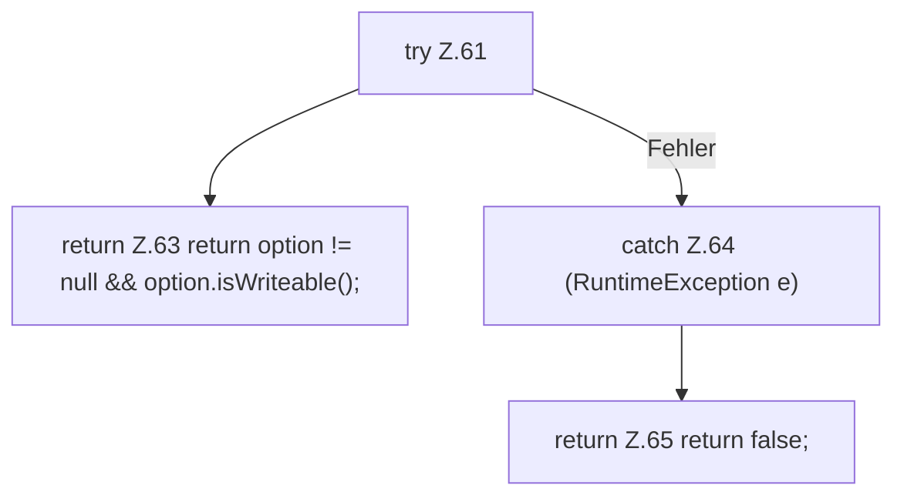

[[00 Start]] › [[Host-Betrieb]] › [[Host-Minimieren]] › [[HostHeapTune]] › [[HostHeapTune.hotspot]] › [[HostHeapTune.hotspot.manageable]]

# HostHeapTune.hotspot.manageable

`HostHeapTune.manageable(String name)` [src/main/java/de/aichele/childlauncher/HostHeapTune.java:60–67](https://github.com/Sciddie/minecraft-serverhoster-plugin/blob/95b02b953b0b4c23673e900e021a7c3c844aa37d/src/main/java/de/aichele/childlauncher/HostHeapTune.java#L60-L67)



```knoten
try Z.61
  Zeile 61: Versuch. Der Fehlerpfad geht in catch.
return Z.63 return option != null && option.isWriteable();
  Zeile 63: Rückgabe `return option != null && option.isWriteable();`.
catch Z.64 (RuntimeException e)
  Zeile 64: fängt (RuntimeException e).
return Z.65 return false;
  Zeile 65: Rückgabe `return false;`.
```

- `manageable` in `src/main/java/de/aichele/childlauncher/HostHeapTune.java`
