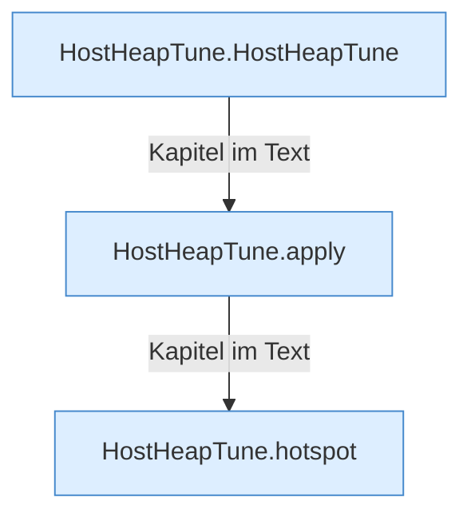

[[00 Start]] › [[Host-Betrieb]] › [[Host-Minimieren]] › [[HostHeapTune]]

# HostHeapTune



```knoten
HostHeapTune.HostHeapTune
  Dieser Teil kümmert sich um den Programmspeicher die Anpassung. Im [[Glossar#Quelltext|Quelltext]] heißt das `HostHeapTune`.
HostHeapTune.apply
  Dieser Teil wendet an das. Im [[Glossar#Quelltext|Quelltext]] heißt das `apply`.
HostHeapTune.hotspot
  Dieser Teil macht hier einen einzelnen Schritt. Eine Ebene tiefer steht er genauer. Im [[Glossar#Quelltext|Quelltext]] heißt das `hotspot`.
```

> [!knoten]- Was die Blöcke tun
> - **HostHeapTune.HostHeapTune**: Dieser Teil kümmert sich um den Programmspeicher die Anpassung. Im [[Glossar#Quelltext|Quelltext]] heißt das `HostHeapTune`.
> - **HostHeapTune.apply**: Dieser Teil wendet an das. Im [[Glossar#Quelltext|Quelltext]] heißt das `apply`.
> - **HostHeapTune.hotspot**: Dieser Teil macht hier einen einzelnen Schritt. Eine Ebene tiefer steht er genauer. Im [[Glossar#Quelltext|Quelltext]] heißt das `hotspot`.

- Setzt die Speicherwerte, mit denen der verkleinerte [[Glossar#Host|Host]] starten soll.
