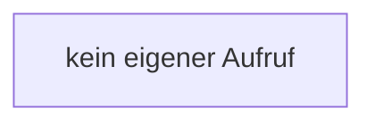

[[00 Start]] › [[Host-Betrieb]] › [[Host-Minimieren]] › [[HostLobbyRuntime]] › [[HostLobbyRuntime.HostLobbyRuntime]]

# HostLobbyRuntime.HostLobbyRuntime

`HostLobbyRuntime.HostLobbyRuntime()` [src/main/java/de/aichele/childlauncher/HostLobbyRuntime.java:18–18](https://github.com/Sciddie/minecraft-serverhoster-plugin/blob/95b02b953b0b4c23673e900e021a7c3c844aa37d/src/main/java/de/aichele/childlauncher/HostLobbyRuntime.java#L18-L18)

- `HostLobbyRuntime` in `src/main/java/de/aichele/childlauncher/HostLobbyRuntime.java`
