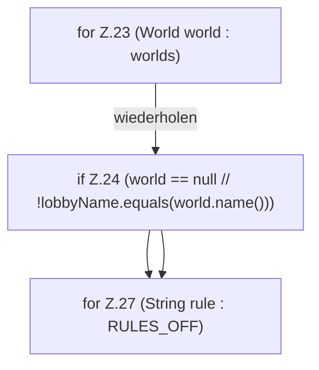

[[00 Start]] › [[Host-Betrieb]] › [[Host-Minimieren]] › [[HostLobbyRuntime]] › [[HostLobbyRuntime.apply]] › [[HostLobbyRuntime.apply.Z23]]

# HostLobbyRuntime.apply.Z23



```knoten
for Z.23 (World world : worlds)
  Zeile 23: Schleife `(World world : worlds)`.
if Z.24 (world == null // !lobbyName.equals(world.name()))
  Zeile 24: prüft `(world == null // !lobbyName.equals(world.name()))`.
for Z.27 (String rule : RULES_OFF)
  Zeile 27: Schleife `(String rule : RULES_OFF)`.
```

- Fortsetzung von `HostLobbyRuntime.apply`, Quellreihenfolge.
