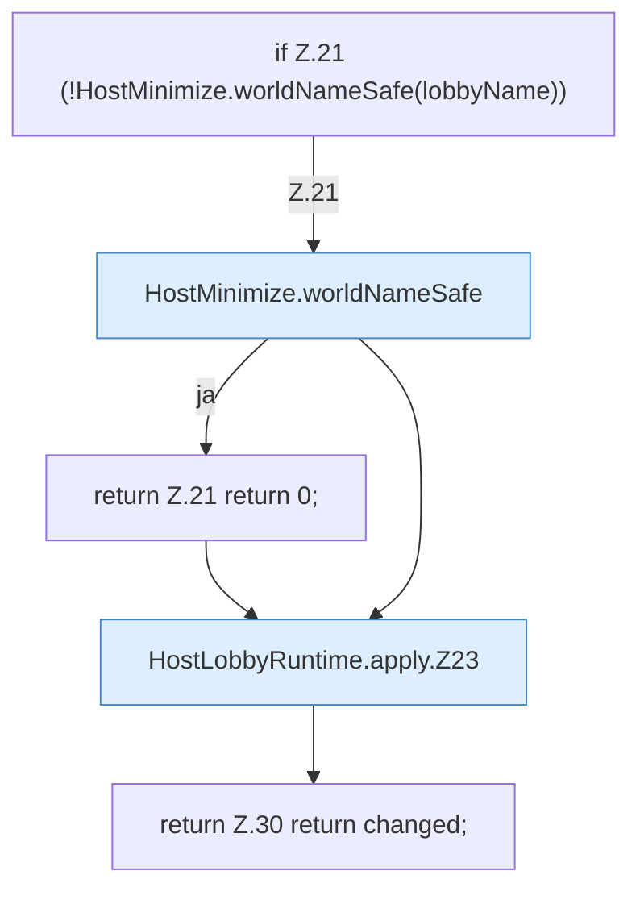

[[00 Start]] › [[Host-Betrieb]] › [[Host-Minimieren]] › [[HostLobbyRuntime]] › [[HostLobbyRuntime.apply]]

# HostLobbyRuntime.apply

`HostLobbyRuntime.apply(Iterable<World> worlds, String lobbyName)` [src/main/java/de/aichele/childlauncher/HostLobbyRuntime.java:20–31](https://github.com/Sciddie/minecraft-serverhoster-plugin/blob/95b02b953b0b4c23673e900e021a7c3c844aa37d/src/main/java/de/aichele/childlauncher/HostLobbyRuntime.java#L20-L31)



```knoten
if Z.21 (!HostMinimize.worldNameSafe(lobbyName))
  Zeile 21: prüft `(!HostMinimize.worldNameSafe(lobbyName))`.
HostMinimize.worldNameSafe
  Betrifft die Welt `worldNameSafe`.
return Z.21 return 0;
  Zeile 21: Rückgabe `return 0;`.
HostLobbyRuntime.apply.Z23
  Fortsetzung des Ablaufs ab Zeile 23.
return Z.30 return changed;
  Zeile 30: Rückgabe `return changed;`.
```

- `apply` in `src/main/java/de/aichele/childlauncher/HostLobbyRuntime.java`
