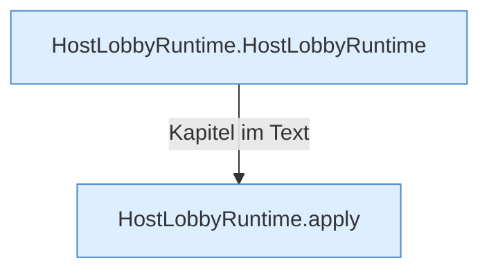

[[00 Start]] › [[Host-Betrieb]] › [[Host-Minimieren]] › [[HostLobbyRuntime]]

# HostLobbyRuntime



```knoten
HostLobbyRuntime.HostLobbyRuntime
  Dieser Teil macht hier einen einzelnen Schritt. Eine Ebene tiefer steht er genauer. Im [[Glossar#Quelltext|Quelltext]] heißt das `HostLobbyRuntime`.
HostLobbyRuntime.apply
  Dieser Teil wendet an das. Im [[Glossar#Quelltext|Quelltext]] heißt das `apply`.
```

> [!knoten]- Was die Blöcke tun
> - **HostLobbyRuntime.HostLobbyRuntime**: Dieser Teil macht hier einen einzelnen Schritt. Eine Ebene tiefer steht er genauer. Im [[Glossar#Quelltext|Quelltext]] heißt das `HostLobbyRuntime`.
> - **HostLobbyRuntime.apply**: Dieser Teil wendet an das. Im [[Glossar#Quelltext|Quelltext]] heißt das `apply`.

- Hält auf dem [[Glossar#Host|Host]] eine kleine Wartewelt, während der [[Glossar#Spielserver|Spielserver]] läuft.
