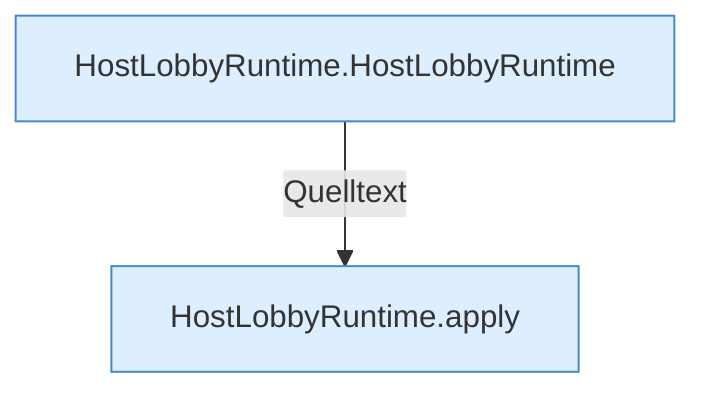

[[00 Start]] › [[Host-Betrieb]] › [[Host-Minimieren]] › [[HostLobbyRuntime]]

# HostLobbyRuntime



```knoten
HostLobbyRuntime.HostLobbyRuntime
  Betrifft den Host `HostLobbyRuntime`.
HostLobbyRuntime.apply
  Wendet an `apply`. Ruft `worldNameSafe`.
```


