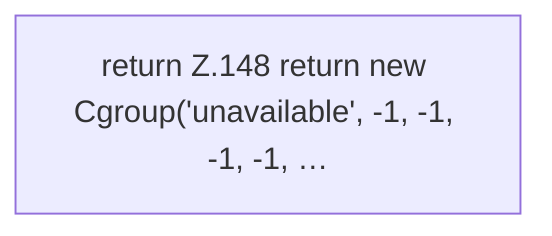

[[00 Start]] › [[Host-Betrieb]] › [[Speicher-Messung]] › [[HostMemoryProbe]] › [[Cgroup]] › [[HostMemoryProbe.Cgroup.unavailable]]

# HostMemoryProbe.Cgroup.unavailable

`HostMemoryProbe.Cgroup.unavailable()` [src/main/java/de/aichele/childlauncher/HostMemoryProbe.java:148–148](https://github.com/Sciddie/minecraft-serverhoster-plugin/blob/95b02b953b0b4c23673e900e021a7c3c844aa37d/src/main/java/de/aichele/childlauncher/HostMemoryProbe.java#L148-L148)



```knoten
return Z.148 return new Cgroup('unavailable', -1, -1, -1, -1, …
  Zeile 148: Rückgabe `return new Cgroup('unavailable', -1, -1, -1, -1, …`.
```

- `unavailable` in `src/main/java/de/aichele/childlauncher/HostMemoryProbe.java`
