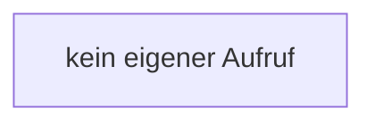

[[00 Start]] › [[Host-Betrieb]] › [[Speicher-Messung]] › [[HostMemoryProbe]] › [[HostMemoryProbe.HostMemoryProbe]]

# HostMemoryProbe.HostMemoryProbe

`HostMemoryProbe.HostMemoryProbe()` [src/main/java/de/aichele/childlauncher/HostMemoryProbe.java:35–35](https://github.com/Sciddie/minecraft-serverhoster-plugin/blob/95b02b953b0b4c23673e900e021a7c3c844aa37d/src/main/java/de/aichele/childlauncher/HostMemoryProbe.java#L35-L35)



```knoten
kein eigener Aufruf
  In diesem Stück gibt es keinen weiteren eigenen Aufruf.
```

> [!knoten]- Was die Blöcke tun
> - **kein eigener Aufruf**: In diesem Stück gibt es keinen weiteren eigenen Aufruf.

- Die Messung kümmert sich um den [[Glossar#Arbeitsspeicher|Arbeitsspeicher]] die Messung.
- `HostMemoryProbe` in `src/main/java/de/aichele/childlauncher/HostMemoryProbe.java`
