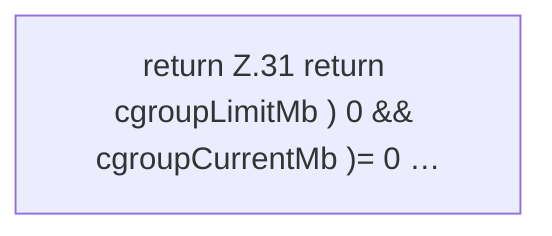

[[00 Start]] › [[Host-Betrieb]] › [[Speicher-Messung]] › [[HostMemoryProbe]] › [[Snapshot]] › [[HostMemoryProbe.Snapshot.cgroupUsePercent]]

# HostMemoryProbe.Snapshot.cgroupUsePercent

`HostMemoryProbe.Snapshot.cgroupUsePercent()` [src/main/java/de/aichele/childlauncher/HostMemoryProbe.java:30–32](https://github.com/Sciddie/minecraft-serverhoster-plugin/blob/95b02b953b0b4c23673e900e021a7c3c844aa37d/src/main/java/de/aichele/childlauncher/HostMemoryProbe.java#L30-L32)



```knoten
return Z.31 return cgroupLimitMb ) 0 && cgroupCurrentMb )= 0 …
  Zeile 31: Rückgabe `return cgroupLimitMb ) 0 && cgroupCurrentMb )= 0 …`.
```

- `cgroupUsePercent` in `src/main/java/de/aichele/childlauncher/HostMemoryProbe.java`
