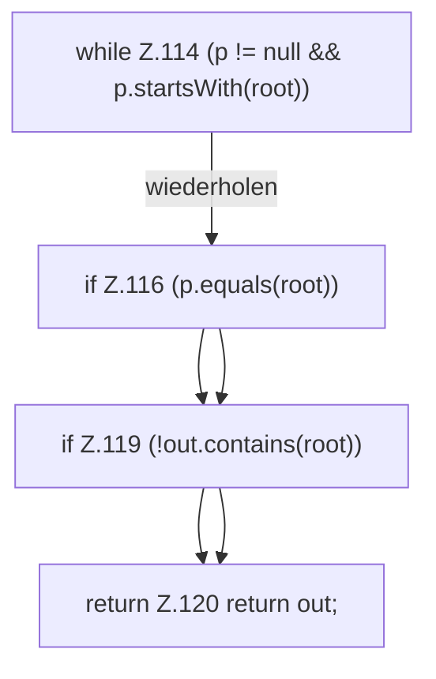

[[00 Start]] › [[Host-Betrieb]] › [[Speicher-Messung]] › [[HostMemoryProbe]] › [[HostMemoryProbe.ancestors]]

# HostMemoryProbe.ancestors

`HostMemoryProbe.ancestors(Path from, Path boundary)` [src/main/java/de/aichele/childlauncher/HostMemoryProbe.java:110–121](https://github.com/Sciddie/minecraft-serverhoster-plugin/blob/95b02b953b0b4c23673e900e021a7c3c844aa37d/src/main/java/de/aichele/childlauncher/HostMemoryProbe.java#L110-L121)



```knoten
while Z.114 (p != null && p.startsWith(root))
  Zeile 114: Schleife `(p != null && p.startsWith(root))`.
if Z.116 (p.equals(root))
  Zeile 116: prüft `(p.equals(root))`.
if Z.119 (!out.contains(root))
  Zeile 119: prüft `(!out.contains(root))`.
return Z.120 return out;
  Zeile 120: Rückgabe `return out;`.
```

> [!knoten]- Was die Blöcke tun
> - **while Z.114 (p != null && p.startsWith(root))**: Zeile 114: Schleife `(p != null && p.startsWith(root))`.
> - **if Z.116 (p.equals(root))**: Zeile 116: prüft `(p.equals(root))`.
> - **if Z.119 (!out.contains(root))**: Zeile 119: prüft `(!out.contains(root))`.
> - **return Z.120 return out;**: Zeile 120: Rückgabe `return out;`.

- Die Messung macht hier einen einzelnen Schritt. Eine Ebene tiefer steht er genauer.
- `ancestors` in `src/main/java/de/aichele/childlauncher/HostMemoryProbe.java`
