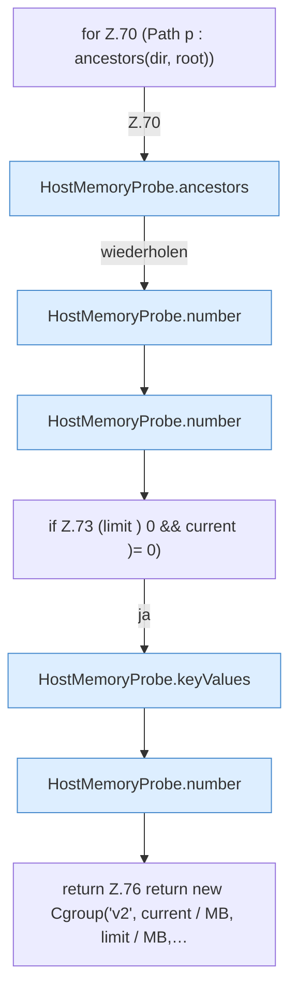

[[00 Start]] › [[Host-Betrieb]] › [[Speicher-Messung]] › [[HostMemoryProbe]] › [[HostMemoryProbe.cgroup]] › [[HostMemoryProbe.cgroup.Z64.Z65.Z68.Z70]]

# HostMemoryProbe.cgroup.Z64.Z65.Z68.Z70



```knoten
for Z.70 (Path p : ancestors(dir, root))
  Zeile 70: Schleife `(Path p : ancestors(dir, root))`.
HostMemoryProbe.ancestors
  Die Messung macht hier einen einzelnen Schritt. Eine Ebene tiefer steht er genauer. `ancestors` in `HostMemoryProbe.java`.
HostMemoryProbe.number
  Die Messung macht hier einen einzelnen Schritt. Eine Ebene tiefer steht er genauer. `number` in `HostMemoryProbe.java`.
if Z.73 (limit ) 0 && current )= 0)
  Zeile 73: prüft `(limit ) 0 && current )= 0)`.
HostMemoryProbe.keyValues
  Die Messung macht hier einen einzelnen Schritt. Eine Ebene tiefer steht er genauer. `keyValues` in `HostMemoryProbe.java`.
return Z.76 return new Cgroup('v2', current / MB, limit / MB,…
  Zeile 76: Rückgabe `return new Cgroup('v2', current / MB, limit / MB,…`.
```

> [!knoten]- Was die Blöcke tun
> - **for Z.70 (Path p : ancestors(dir, root))**: Zeile 70: Schleife `(Path p : ancestors(dir, root))`.
> - **HostMemoryProbe.ancestors**: Die Messung macht hier einen einzelnen Schritt. Eine Ebene tiefer steht er genauer. `ancestors` in `HostMemoryProbe.java`.
> - **HostMemoryProbe.number**: Die Messung macht hier einen einzelnen Schritt. Eine Ebene tiefer steht er genauer. `number` in `HostMemoryProbe.java`.
> - **if Z.73 (limit ) 0 && current )= 0)**: Zeile 73: prüft `(limit ) 0 && current )= 0)`.
> - **HostMemoryProbe.keyValues**: Die Messung macht hier einen einzelnen Schritt. Eine Ebene tiefer steht er genauer. `keyValues` in `HostMemoryProbe.java`.
> - **return Z.76 return new Cgroup('v2', current / MB, limit / MB,…**: Zeile 76: Rückgabe `return new Cgroup('v2', current / MB, limit / MB,…`.

- Der Ablauf geht in [[Glossar#Zeile|Zeile]] 70 weiter. Eine Ebene tiefer steht er genauer.
- Fortsetzung von `HostMemoryProbe.cgroup.Z64.Z65.Z68`.
