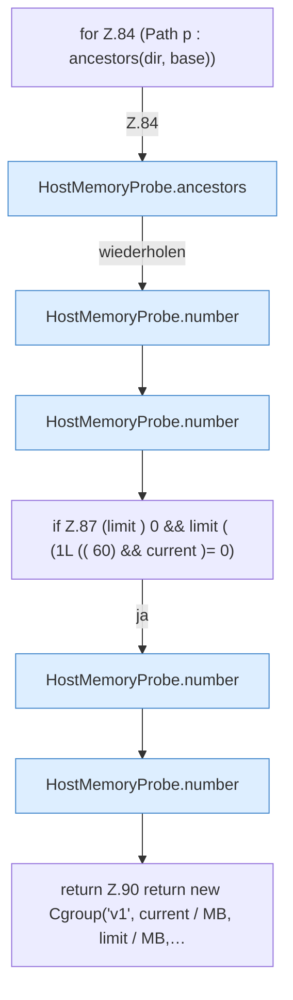

[[00 Start]] › [[Host-Betrieb]] › [[Speicher-Messung]] › [[HostMemoryProbe]] › [[HostMemoryProbe.cgroup]] › [[HostMemoryProbe.cgroup.Z64.Z65.Z68.Z81.Z82.Z84]]

# HostMemoryProbe.cgroup.Z64.Z65.Z68.Z81.Z82.Z84



```knoten
for Z.84 (Path p : ancestors(dir, base))
  Zeile 84: Schleife `(Path p : ancestors(dir, base))`.
HostMemoryProbe.ancestors
  Die Messung macht hier einen einzelnen Schritt. Eine Ebene tiefer steht er genauer. `ancestors` in `HostMemoryProbe.java`.
HostMemoryProbe.number
  Die Messung macht hier einen einzelnen Schritt. Eine Ebene tiefer steht er genauer. `number` in `HostMemoryProbe.java`.
if Z.87 (limit ) 0 && limit ( (1L (( 60) && current )= 0)
  Zeile 87: prüft `(limit ) 0 && limit ( (1L (( 60) && current )= 0)`.
return Z.90 return new Cgroup('v1', current / MB, limit / MB,…
  Zeile 90: Rückgabe `return new Cgroup('v1', current / MB, limit / MB,…`.
```

> [!knoten]- Was die Blöcke tun
> - **for Z.84 (Path p : ancestors(dir, base))**: Zeile 84: Schleife `(Path p : ancestors(dir, base))`.
> - **HostMemoryProbe.ancestors**: Die Messung macht hier einen einzelnen Schritt. Eine Ebene tiefer steht er genauer. `ancestors` in `HostMemoryProbe.java`.
> - **HostMemoryProbe.number**: Die Messung macht hier einen einzelnen Schritt. Eine Ebene tiefer steht er genauer. `number` in `HostMemoryProbe.java`.
> - **if Z.87 (limit ) 0 && limit ( (1L (( 60) && current )= 0)**: Zeile 87: prüft `(limit ) 0 && limit ( (1L (( 60) && current )= 0)`.
> - **return Z.90 return new Cgroup('v1', current / MB, limit / MB,…**: Zeile 90: Rückgabe `return new Cgroup('v1', current / MB, limit / MB,…`.

- Der Ablauf geht in [[Glossar#Zeile|Zeile]] 84 weiter. Eine Ebene tiefer steht er genauer.
- Fortsetzung von `HostMemoryProbe.cgroup.Z64.Z65.Z68.Z81.Z82`.
