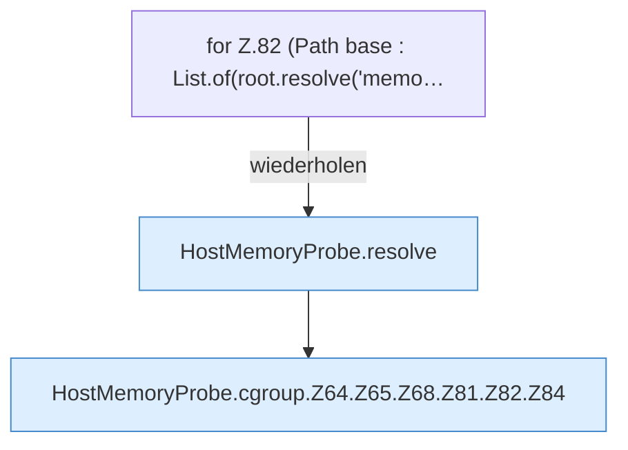

[[00 Start]] › [[Host-Betrieb]] › [[Speicher-Messung]] › [[HostMemoryProbe]] › [[HostMemoryProbe.cgroup]] › [[HostMemoryProbe.cgroup.Z64.Z65.Z68.Z81.Z82]]

# HostMemoryProbe.cgroup.Z64.Z65.Z68.Z81.Z82



```knoten
for Z.82 (Path base : List.of(root.resolve('memo…
  Zeile 82: Schleife `(Path base : List.of(root.resolve('memo…`.
HostMemoryProbe.resolve
  Die Messung bestimmt das. Löst auf `resolve`.
HostMemoryProbe.cgroup.Z64.Z65.Z68.Z81.Z82.Z84
  Der Ablauf geht in [[Glossar#Zeile|Zeile]] 84 weiter. Eine Ebene tiefer steht er genauer. Fortsetzung des Ablaufs ab Zeile 84.
```

> [!knoten]- Was die Blöcke tun
> - **for Z.82 (Path base : List.of(root.resolve('memo…**: Zeile 82: Schleife `(Path base : List.of(root.resolve('memo…`.
> - **HostMemoryProbe.resolve**: Die Messung bestimmt das. Löst auf `resolve`.
> - **HostMemoryProbe.cgroup.Z64.Z65.Z68.Z81.Z82.Z84**: Der Ablauf geht in [[Glossar#Zeile|Zeile]] 84 weiter. Eine Ebene tiefer steht er genauer. Fortsetzung des Ablaufs ab Zeile 84.

- Der Ablauf geht in [[Glossar#Zeile|Zeile]] 82 weiter. Eine Ebene tiefer steht er genauer.
- Fortsetzung von `HostMemoryProbe.cgroup.Z64.Z65.Z68.Z81`.
