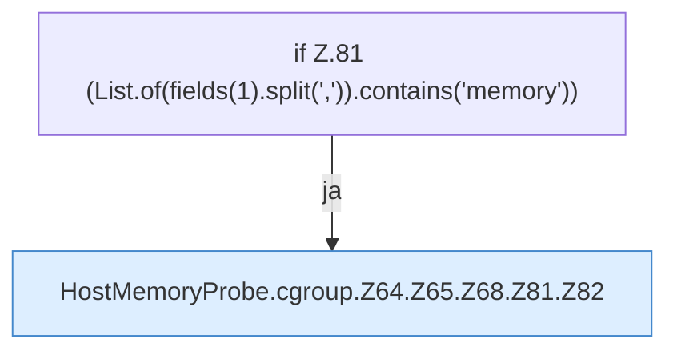

[[00 Start]] › [[Host-Betrieb]] › [[Speicher-Messung]] › [[HostMemoryProbe]] › [[HostMemoryProbe.cgroup]] › [[HostMemoryProbe.cgroup.Z64.Z65.Z68.Z81]]

# HostMemoryProbe.cgroup.Z64.Z65.Z68.Z81



```knoten
if Z.81 (List.of(fields(1).split(',')).contains('memory'))
  Zeile 81: prüft `(List.of(fields(1).split(',')).contains('memory'))`.
HostMemoryProbe.cgroup.Z64.Z65.Z68.Z81.Z82
  Fortsetzung des Ablaufs ab Zeile 82.
```

- Fortsetzung von `HostMemoryProbe.cgroup.Z64.Z65.Z68`, Quellreihenfolge.
