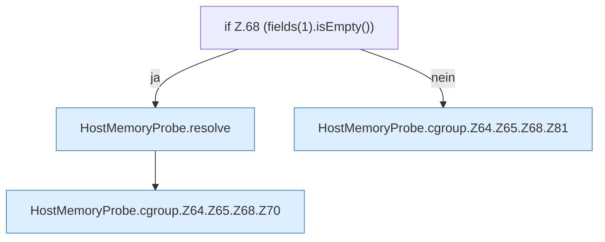

[[00 Start]] › [[Host-Betrieb]] › [[Speicher-Messung]] › [[HostMemoryProbe]] › [[HostMemoryProbe.cgroup]] › [[HostMemoryProbe.cgroup.Z64.Z65.Z68]]

# HostMemoryProbe.cgroup.Z64.Z65.Z68



```knoten
if Z.68 (fields(1).isEmpty())
  Zeile 68: prüft `(fields(1).isEmpty())`.
HostMemoryProbe.resolve
  Die Messung bestimmt das. Löst auf `resolve`.
HostMemoryProbe.cgroup.Z64.Z65.Z68.Z70
  Der Ablauf geht in [[Glossar#Zeile|Zeile]] 70 weiter. Eine Ebene tiefer steht er genauer. Fortsetzung des Ablaufs ab Zeile 70.
HostMemoryProbe.cgroup.Z64.Z65.Z68.Z81
  Der Ablauf geht in [[Glossar#Zeile|Zeile]] 81 weiter. Eine Ebene tiefer steht er genauer. Fortsetzung des Ablaufs ab Zeile 81.
```

> [!knoten]- Was die Blöcke tun
> - **if Z.68 (fields(1).isEmpty())**: Zeile 68: prüft `(fields(1).isEmpty())`.
> - **HostMemoryProbe.resolve**: Die Messung bestimmt das. Löst auf `resolve`.
> - **HostMemoryProbe.cgroup.Z64.Z65.Z68.Z70**: Der Ablauf geht in [[Glossar#Zeile|Zeile]] 70 weiter. Eine Ebene tiefer steht er genauer. Fortsetzung des Ablaufs ab Zeile 70.
> - **HostMemoryProbe.cgroup.Z64.Z65.Z68.Z81**: Der Ablauf geht in [[Glossar#Zeile|Zeile]] 81 weiter. Eine Ebene tiefer steht er genauer. Fortsetzung des Ablaufs ab Zeile 81.

- Der Ablauf geht in [[Glossar#Zeile|Zeile]] 68 weiter. Eine Ebene tiefer steht er genauer.
- Fortsetzung von `HostMemoryProbe.cgroup.Z64.Z65`.
