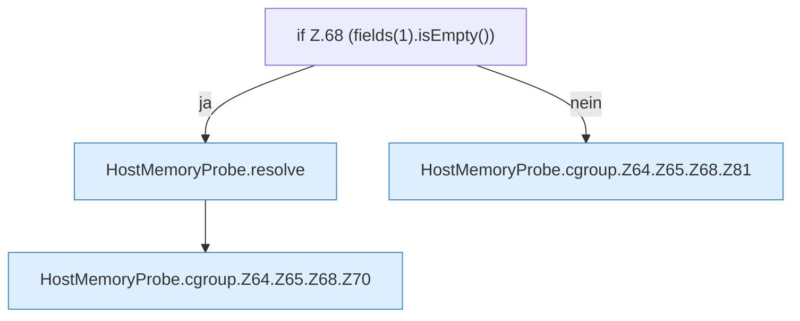

[[00 Start]] › [[Host-Betrieb]] › [[Speicher-Messung]] › [[HostMemoryProbe]] › [[HostMemoryProbe.cgroup]] › [[HostMemoryProbe.cgroup.Z64.Z65.Z68]]

# HostMemoryProbe.cgroup.Z64.Z65.Z68

- Fortsetzung von `HostMemoryProbe.cgroup.Z64.Z65`, Quellreihenfolge.
