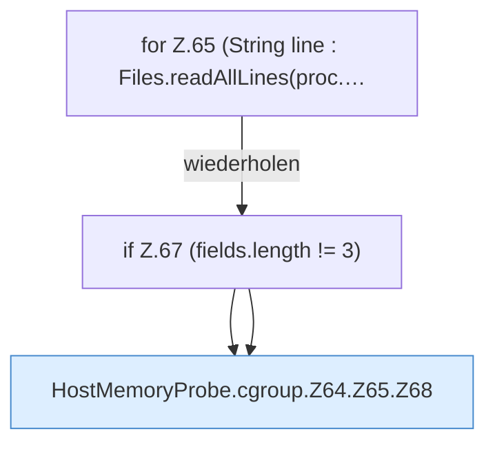

[[00 Start]] › [[Host-Betrieb]] › [[Speicher-Messung]] › [[HostMemoryProbe]] › [[HostMemoryProbe.cgroup]] › [[HostMemoryProbe.cgroup.Z64.Z65]]

# HostMemoryProbe.cgroup.Z64.Z65



```knoten
for Z.65 (String line : Files.readAllLines(proc.…
  Zeile 65: Schleife `(String line : Files.readAllLines(proc.…`.
if Z.67 (fields.length != 3)
  Zeile 67: prüft `(fields.length != 3)`.
HostMemoryProbe.cgroup.Z64.Z65.Z68
  Fortsetzung des Ablaufs ab Zeile 68.
```

- Fortsetzung von `HostMemoryProbe.cgroup.Z64`, Quellreihenfolge.
