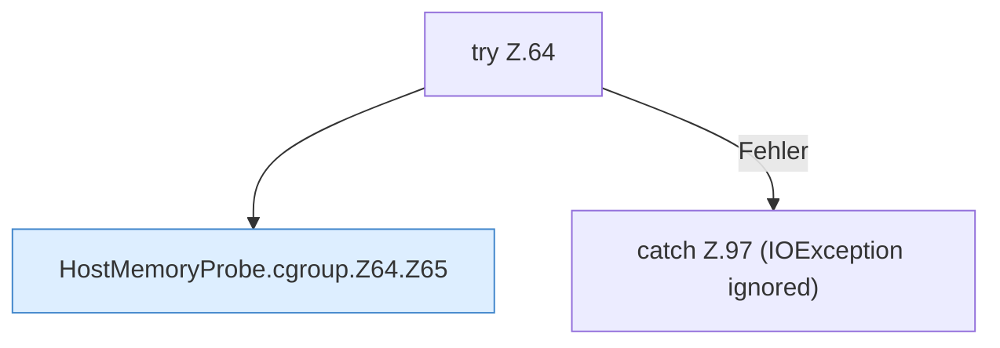

[[00 Start]] › [[Host-Betrieb]] › [[Speicher-Messung]] › [[HostMemoryProbe]] › [[HostMemoryProbe.cgroup]] › [[HostMemoryProbe.cgroup.Z64]]

# HostMemoryProbe.cgroup.Z64



```knoten
try Z.64
  Zeile 64: Versuch. Der Fehlerpfad geht in catch.
HostMemoryProbe.cgroup.Z64.Z65
  Der Ablauf geht in [[Glossar#Zeile|Zeile]] 65 weiter. Eine Ebene tiefer steht er genauer. Fortsetzung des Ablaufs ab Zeile 65.
catch Z.97 (IOException ignored)
  Zeile 97: fängt (IOException ignored).
```

> [!knoten]- Was die Blöcke tun
> - **try Z.64**: Zeile 64: Versuch. Der Fehlerpfad geht in catch.
> - **HostMemoryProbe.cgroup.Z64.Z65**: Der Ablauf geht in [[Glossar#Zeile|Zeile]] 65 weiter. Eine Ebene tiefer steht er genauer. Fortsetzung des Ablaufs ab Zeile 65.
> - **catch Z.97 (IOException ignored)**: Zeile 97: fängt (IOException ignored).

- Der Ablauf geht in [[Glossar#Zeile|Zeile]] 64 weiter. Eine Ebene tiefer steht er genauer.
- Fortsetzung von `HostMemoryProbe.cgroup`.
