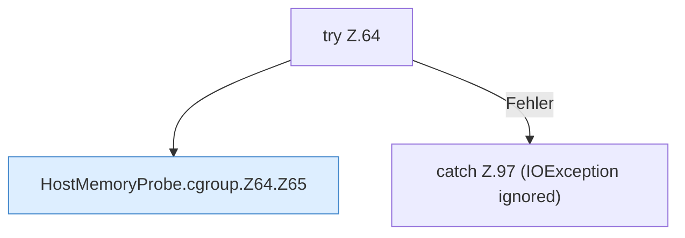

[[00 Start]] › [[Host-Betrieb]] › [[Speicher-Messung]] › [[HostMemoryProbe]] › [[HostMemoryProbe.cgroup]] › [[HostMemoryProbe.cgroup.Z64]]

# HostMemoryProbe.cgroup.Z64

- Fortsetzung von `HostMemoryProbe.cgroup`, Quellreihenfolge.
