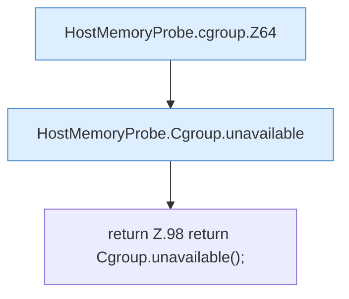

[[00 Start]] › [[Host-Betrieb]] › [[Speicher-Messung]] › [[HostMemoryProbe]] › [[HostMemoryProbe.cgroup]]

# HostMemoryProbe.cgroup

`HostMemoryProbe.cgroup(Path proc, Path root)` [src/main/java/de/aichele/childlauncher/HostMemoryProbe.java:63–99](https://github.com/Sciddie/minecraft-serverhoster-plugin/blob/95b02b953b0b4c23673e900e021a7c3c844aa37d/src/main/java/de/aichele/childlauncher/HostMemoryProbe.java#L63-L99)



```knoten
HostMemoryProbe.cgroup.Z64
  Der Ablauf geht in [[Glossar#Zeile|Zeile]] 64 weiter. Eine Ebene tiefer steht er genauer. Fortsetzung des Ablaufs ab Zeile 64.
HostMemoryProbe.Cgroup.unavailable
  Die Messung macht hier einen einzelnen Schritt. Eine Ebene tiefer steht er genauer. `unavailable` in `HostMemoryProbe.java`.
return Z.98 return Cgroup.unavailable();
  Zeile 98: Rückgabe `return Cgroup.unavailable();`.
```

> [!knoten]- Was die Blöcke tun
> - **HostMemoryProbe.cgroup.Z64**: Der Ablauf geht in [[Glossar#Zeile|Zeile]] 64 weiter. Eine Ebene tiefer steht er genauer. Fortsetzung des Ablaufs ab Zeile 64.
> - **HostMemoryProbe.Cgroup.unavailable**: Die Messung macht hier einen einzelnen Schritt. Eine Ebene tiefer steht er genauer. `unavailable` in `HostMemoryProbe.java`.
> - **return Z.98 return Cgroup.unavailable();**: Zeile 98: Rückgabe `return Cgroup.unavailable();`.

- Die Messung macht hier einen einzelnen Schritt. Eine Ebene tiefer steht er genauer.
- `cgroup` in `src/main/java/de/aichele/childlauncher/HostMemoryProbe.java`
