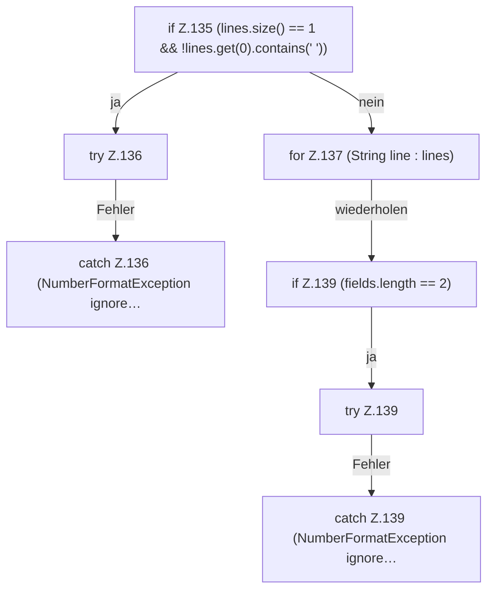

[[00 Start]] › [[Host-Betrieb]] › [[Speicher-Messung]] › [[HostMemoryProbe]] › [[HostMemoryProbe.keyValues]] › [[HostMemoryProbe.keyValues.Z133.Z135]]

# HostMemoryProbe.keyValues.Z133.Z135

- Fortsetzung von `HostMemoryProbe.keyValues.Z133`, Quellreihenfolge.
