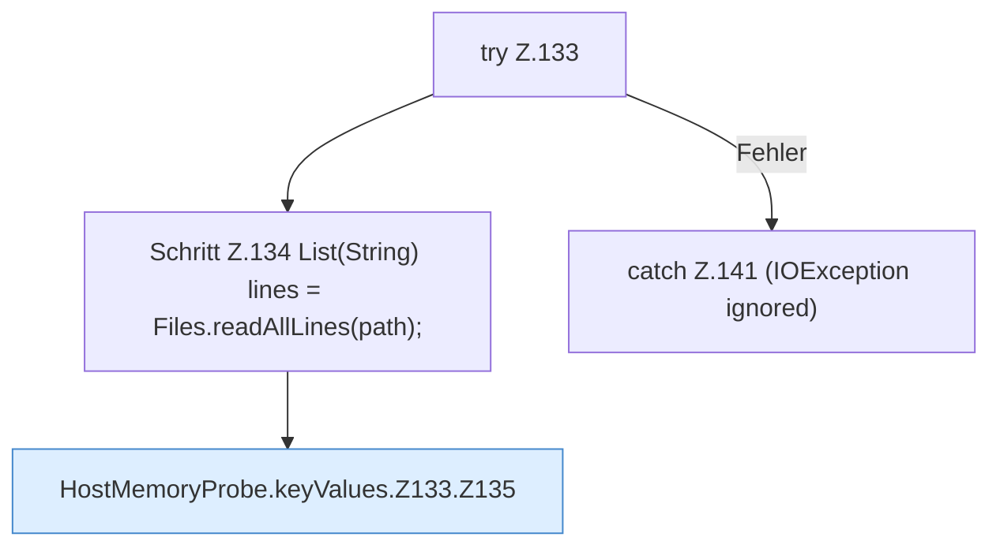

[[00 Start]] › [[Host-Betrieb]] › [[Speicher-Messung]] › [[HostMemoryProbe]] › [[HostMemoryProbe.keyValues]] › [[HostMemoryProbe.keyValues.Z133]]

# HostMemoryProbe.keyValues.Z133



```knoten
try Z.133
  Zeile 133: Versuch. Der Fehlerpfad geht in catch.
Schritt Z.134 List(String) lines = Files.readAllLines(path);
  Zeile 134: Dateioperation. `List(String) lines = Files.readAllLines(path);`
HostMemoryProbe.keyValues.Z133.Z135
  Der Ablauf geht in [[Glossar#Zeile|Zeile]] 135 weiter. Eine Ebene tiefer steht er genauer. Fortsetzung des Ablaufs ab Zeile 135.
catch Z.141 (IOException ignored)
  Zeile 141: fängt (IOException ignored).
```

> [!knoten]- Was die Blöcke tun
> - **try Z.133**: Zeile 133: Versuch. Der Fehlerpfad geht in catch.
> - **Schritt Z.134 List(String) lines = Files.readAllLines(path);**: Zeile 134: Dateioperation. `List(String) lines = Files.readAllLines(path);`
> - **HostMemoryProbe.keyValues.Z133.Z135**: Der Ablauf geht in [[Glossar#Zeile|Zeile]] 135 weiter. Eine Ebene tiefer steht er genauer. Fortsetzung des Ablaufs ab Zeile 135.
> - **catch Z.141 (IOException ignored)**: Zeile 141: fängt (IOException ignored).

- Der Ablauf geht in [[Glossar#Zeile|Zeile]] 133 weiter. Eine Ebene tiefer steht er genauer.
- Fortsetzung von `HostMemoryProbe.keyValues`.
