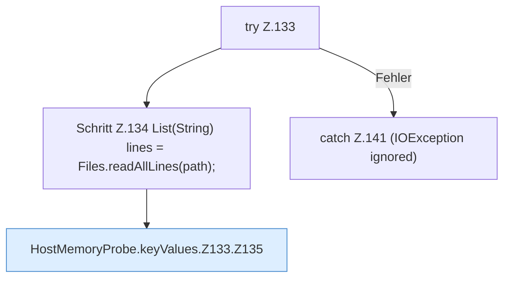

[[00 Start]] › [[Host-Betrieb]] › [[Speicher-Messung]] › [[HostMemoryProbe]] › [[HostMemoryProbe.keyValues]] › [[HostMemoryProbe.keyValues.Z133]]

# HostMemoryProbe.keyValues.Z133

- Fortsetzung von `HostMemoryProbe.keyValues`, Quellreihenfolge.
