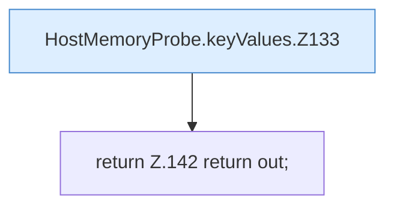

[[00 Start]] › [[Host-Betrieb]] › [[Speicher-Messung]] › [[HostMemoryProbe]] › [[HostMemoryProbe.keyValues]]

# HostMemoryProbe.keyValues

`HostMemoryProbe.keyValues(Path path)` [src/main/java/de/aichele/childlauncher/HostMemoryProbe.java:131–143](https://github.com/Sciddie/minecraft-serverhoster-plugin/blob/95b02b953b0b4c23673e900e021a7c3c844aa37d/src/main/java/de/aichele/childlauncher/HostMemoryProbe.java#L131-L143)



```knoten
HostMemoryProbe.keyValues.Z133
  Fortsetzung des Ablaufs ab Zeile 133.
return Z.142 return out;
  Zeile 142: Rückgabe `return out;`.
```

- `keyValues` in `src/main/java/de/aichele/childlauncher/HostMemoryProbe.java`
