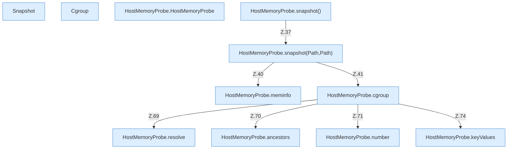

[[00 Start]] › [[Host-Betrieb]] › [[Speicher-Messung]] › [[HostMemoryProbe]]

# HostMemoryProbe



```knoten
Snapshot
  Eine einzelne Messung: freier Speicher und Wechselbereich in diesem Moment.
Cgroup
  Eine Messung aus der Gruppenbegrenzung von Linux, falls der [[Glossar#Host|Host]] so begrenzt ist. Sie sagt, wie viel die Gruppe gerade verbraucht und wie viel sie darf.
HostMemoryProbe.HostMemoryProbe
  Die Messung kümmert sich um den [[Glossar#Arbeitsspeicher|Arbeitsspeicher]] die Messung. Im [[Glossar#Quelltext|Quelltext]] heißt das `HostMemoryProbe`.
HostMemoryProbe.snapshot()
  Die Messung macht hier einen einzelnen Schritt. Eine Ebene tiefer steht er genauer. Im [[Glossar#Quelltext|Quelltext]] heißt das `snapshot()`.
HostMemoryProbe.snapshot(Path,Path)
  Die Messung macht hier einen einzelnen Schritt. Eine Ebene tiefer steht er genauer. Im [[Glossar#Quelltext|Quelltext]] heißt das `snapshot(Path,Path)`.
HostMemoryProbe.meminfo
  Die Messung macht hier einen einzelnen Schritt. Eine Ebene tiefer steht er genauer. Im [[Glossar#Quelltext|Quelltext]] heißt das `meminfo`.
HostMemoryProbe.cgroup
  Die Messung macht hier einen einzelnen Schritt. Eine Ebene tiefer steht er genauer. Im [[Glossar#Quelltext|Quelltext]] heißt das `cgroup`.
HostMemoryProbe.resolve
  Die Messung bestimmt das. Im [[Glossar#Quelltext|Quelltext]] heißt das `resolve`.
HostMemoryProbe.ancestors
  Die Messung macht hier einen einzelnen Schritt. Eine Ebene tiefer steht er genauer. Im [[Glossar#Quelltext|Quelltext]] heißt das `ancestors`.
HostMemoryProbe.number
  Die Messung macht hier einen einzelnen Schritt. Eine Ebene tiefer steht er genauer. Im [[Glossar#Quelltext|Quelltext]] heißt das `number`.
HostMemoryProbe.keyValues
  Die Messung macht hier einen einzelnen Schritt. Eine Ebene tiefer steht er genauer. Im [[Glossar#Quelltext|Quelltext]] heißt das `keyValues`.
```

> [!knoten]- Was die Blöcke tun
> - **Snapshot**: Eine einzelne Messung: freier Speicher und Wechselbereich in diesem Moment.
> - **Cgroup**: Eine Messung aus der Gruppenbegrenzung von Linux, falls der [[Glossar#Host|Host]] so begrenzt ist. Sie sagt, wie viel die Gruppe gerade verbraucht und wie viel sie darf.
> - **HostMemoryProbe.HostMemoryProbe**: Die Messung kümmert sich um den [[Glossar#Arbeitsspeicher|Arbeitsspeicher]] die Messung. Im [[Glossar#Quelltext|Quelltext]] heißt das `HostMemoryProbe`.
> - **HostMemoryProbe.snapshot()**: Die Messung macht hier einen einzelnen Schritt. Eine Ebene tiefer steht er genauer. Im [[Glossar#Quelltext|Quelltext]] heißt das `snapshot()`.
> - **HostMemoryProbe.snapshot(Path,Path)**: Die Messung macht hier einen einzelnen Schritt. Eine Ebene tiefer steht er genauer. Im [[Glossar#Quelltext|Quelltext]] heißt das `snapshot(Path,Path)`.
> - **HostMemoryProbe.meminfo**: Die Messung macht hier einen einzelnen Schritt. Eine Ebene tiefer steht er genauer. Im [[Glossar#Quelltext|Quelltext]] heißt das `meminfo`.
> - **HostMemoryProbe.cgroup**: Die Messung macht hier einen einzelnen Schritt. Eine Ebene tiefer steht er genauer. Im [[Glossar#Quelltext|Quelltext]] heißt das `cgroup`.
> - **HostMemoryProbe.resolve**: Die Messung bestimmt das. Im [[Glossar#Quelltext|Quelltext]] heißt das `resolve`.
> - **HostMemoryProbe.ancestors**: Die Messung macht hier einen einzelnen Schritt. Eine Ebene tiefer steht er genauer. Im [[Glossar#Quelltext|Quelltext]] heißt das `ancestors`.
> - **HostMemoryProbe.number**: Die Messung macht hier einen einzelnen Schritt. Eine Ebene tiefer steht er genauer. Im [[Glossar#Quelltext|Quelltext]] heißt das `number`.
> - **HostMemoryProbe.keyValues**: Die Messung macht hier einen einzelnen Schritt. Eine Ebene tiefer steht er genauer. Im [[Glossar#Quelltext|Quelltext]] heißt das `keyValues`.

- Liest, wie viel [[Glossar#Arbeitsspeicher|Arbeitsspeicher]] auf dem [[Glossar#Host|Host]] noch frei ist, inklusive des Wechselbereichs.
