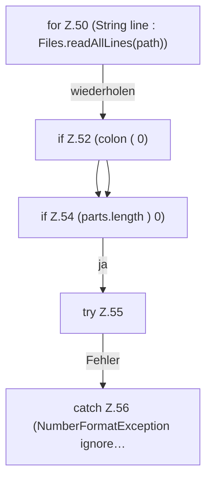

[[00 Start]] › [[Host-Betrieb]] › [[Speicher-Messung]] › [[HostMemoryProbe]] › [[HostMemoryProbe.meminfo]] › [[HostMemoryProbe.meminfo.Z49.Z50]]

# HostMemoryProbe.meminfo.Z49.Z50

- Fortsetzung von `HostMemoryProbe.meminfo.Z49`, Quellreihenfolge.
