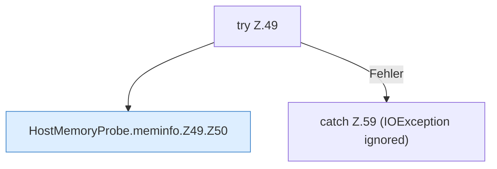

[[00 Start]] › [[Host-Betrieb]] › [[Speicher-Messung]] › [[HostMemoryProbe]] › [[HostMemoryProbe.meminfo]] › [[HostMemoryProbe.meminfo.Z49]]

# HostMemoryProbe.meminfo.Z49

- Fortsetzung von `HostMemoryProbe.meminfo`, Quellreihenfolge.
