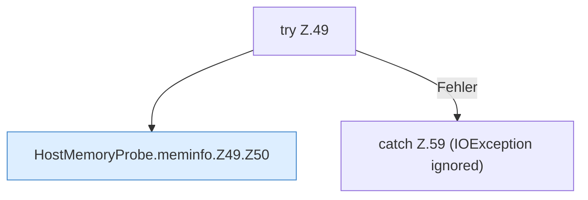

[[00 Start]] › [[Host-Betrieb]] › [[Speicher-Messung]] › [[HostMemoryProbe]] › [[HostMemoryProbe.meminfo]] › [[HostMemoryProbe.meminfo.Z49]]

# HostMemoryProbe.meminfo.Z49



```knoten
try Z.49
  Zeile 49: Versuch. Der Fehlerpfad geht in catch.
HostMemoryProbe.meminfo.Z49.Z50
  Der Ablauf geht in [[Glossar#Zeile|Zeile]] 50 weiter. Eine Ebene tiefer steht er genauer. Fortsetzung des Ablaufs ab Zeile 50.
catch Z.59 (IOException ignored)
  Zeile 59: fängt (IOException ignored).
```

> [!knoten]- Was die Blöcke tun
> - **try Z.49**: Zeile 49: Versuch. Der Fehlerpfad geht in catch.
> - **HostMemoryProbe.meminfo.Z49.Z50**: Der Ablauf geht in [[Glossar#Zeile|Zeile]] 50 weiter. Eine Ebene tiefer steht er genauer. Fortsetzung des Ablaufs ab Zeile 50.
> - **catch Z.59 (IOException ignored)**: Zeile 59: fängt (IOException ignored).

- Der Ablauf geht in [[Glossar#Zeile|Zeile]] 49 weiter. Eine Ebene tiefer steht er genauer.
- Fortsetzung von `HostMemoryProbe.meminfo`.
