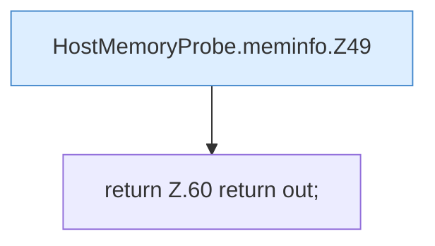

[[00 Start]] › [[Host-Betrieb]] › [[Speicher-Messung]] › [[HostMemoryProbe]] › [[HostMemoryProbe.meminfo]]

# HostMemoryProbe.meminfo

`HostMemoryProbe.meminfo(Path path)` [src/main/java/de/aichele/childlauncher/HostMemoryProbe.java:47–61](https://github.com/Sciddie/minecraft-serverhoster-plugin/blob/95b02b953b0b4c23673e900e021a7c3c844aa37d/src/main/java/de/aichele/childlauncher/HostMemoryProbe.java#L47-L61)



```knoten
HostMemoryProbe.meminfo.Z49
  Der Ablauf geht in [[Glossar#Zeile|Zeile]] 49 weiter. Eine Ebene tiefer steht er genauer. Fortsetzung des Ablaufs ab Zeile 49.
return Z.60 return out;
  Zeile 60: Rückgabe `return out;`.
```

> [!knoten]- Was die Blöcke tun
> - **HostMemoryProbe.meminfo.Z49**: Der Ablauf geht in [[Glossar#Zeile|Zeile]] 49 weiter. Eine Ebene tiefer steht er genauer. Fortsetzung des Ablaufs ab Zeile 49.
> - **return Z.60 return out;**: Zeile 60: Rückgabe `return out;`.

- Die Messung macht hier einen einzelnen Schritt. Eine Ebene tiefer steht er genauer.
- `meminfo` in `src/main/java/de/aichele/childlauncher/HostMemoryProbe.java`
