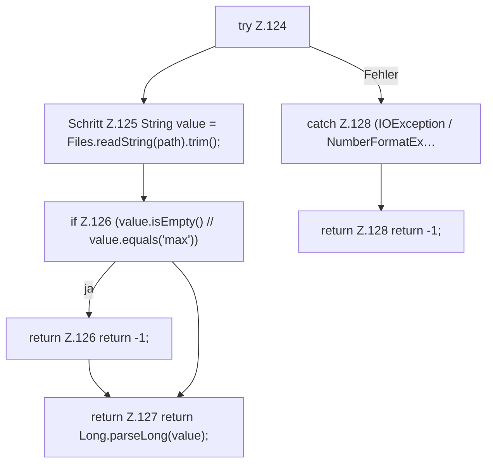

[[00 Start]] › [[Host-Betrieb]] › [[Speicher-Messung]] › [[HostMemoryProbe]] › [[HostMemoryProbe.number]]

# HostMemoryProbe.number

`HostMemoryProbe.number(Path path)` [src/main/java/de/aichele/childlauncher/HostMemoryProbe.java:123–129](https://github.com/Sciddie/minecraft-serverhoster-plugin/blob/95b02b953b0b4c23673e900e021a7c3c844aa37d/src/main/java/de/aichele/childlauncher/HostMemoryProbe.java#L123-L129)



```knoten
try Z.124
  Zeile 124: Versuch. Der Fehlerpfad geht in catch.
Schritt Z.125 String value = Files.readString(path).trim();
  Zeile 125: liest Text aus einer Datei. `String value = Files.readString(path).trim();`
if Z.126 (value.isEmpty() // value.equals('max'))
  Zeile 126: prüft `(value.isEmpty() // value.equals('max'))`.
return Z.126 return -1;
  Zeile 126: Rückgabe `return -1;`.
return Z.127 return Long.parseLong(value);
  Zeile 127: Rückgabe `return Long.parseLong(value);`.
catch Z.128 (IOException / NumberFormatEx…
  Zeile 128: fängt (IOException / NumberFormatEx….
return Z.128 return -1;
  Zeile 128: Rückgabe `return -1;`.
```

> [!knoten]- Was die Blöcke tun
> - **try Z.124**: Zeile 124: Versuch. Der Fehlerpfad geht in catch.
> - **Schritt Z.125 String value = Files.readString(path).trim();**: Zeile 125: liest Text aus einer Datei. `String value = Files.readString(path).trim();`
> - **if Z.126 (value.isEmpty() // value.equals('max'))**: Zeile 126: prüft `(value.isEmpty() // value.equals('max'))`.
> - **return Z.126 return -1;**: Zeile 126: Rückgabe `return -1;`.
> - **return Z.127 return Long.parseLong(value);**: Zeile 127: Rückgabe `return Long.parseLong(value);`.
> - **catch Z.128 (IOException / NumberFormatEx…**: Zeile 128: fängt (IOException / NumberFormatEx….
> - **return Z.128 return -1;**: Zeile 128: Rückgabe `return -1;`.

- Die Messung macht hier einen einzelnen Schritt. Eine Ebene tiefer steht er genauer.
- `number` in `src/main/java/de/aichele/childlauncher/HostMemoryProbe.java`
