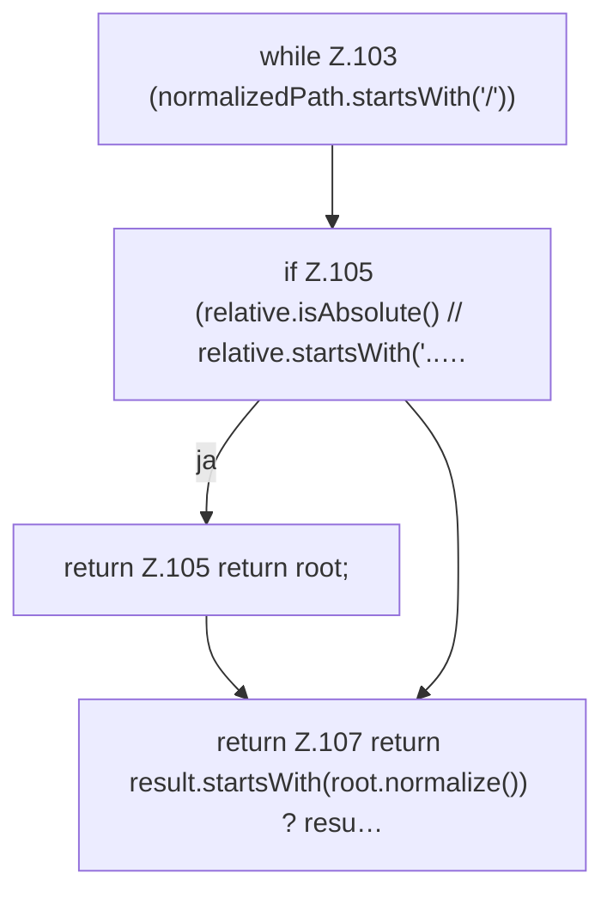

[[00 Start]] › [[Host-Betrieb]] › [[Speicher-Messung]] › [[HostMemoryProbe]] › [[HostMemoryProbe.resolve]]

# HostMemoryProbe.resolve

`HostMemoryProbe.resolve(Path root, String cgroupPath)` [src/main/java/de/aichele/childlauncher/HostMemoryProbe.java:101–108](https://github.com/Sciddie/minecraft-serverhoster-plugin/blob/95b02b953b0b4c23673e900e021a7c3c844aa37d/src/main/java/de/aichele/childlauncher/HostMemoryProbe.java#L101-L108)



```knoten
while Z.103 (normalizedPath.startsWith('/'))
  Zeile 103: Schleife `(normalizedPath.startsWith('/'))`.
if Z.105 (relative.isAbsolute() // relative.startsWith('..…
  Zeile 105: prüft `(relative.isAbsolute() // relative.startsWith('..…`.
return Z.105 return root;
  Zeile 105: Rückgabe `return root;`.
return Z.107 return result.startsWith(root.normalize()) ? resu…
  Zeile 107: Rückgabe `return result.startsWith(root.normalize()) ? resu…`.
```

> [!knoten]- Was die Blöcke tun
> - **while Z.103 (normalizedPath.startsWith('/'))**: Zeile 103: Schleife `(normalizedPath.startsWith('/'))`.
> - **if Z.105 (relative.isAbsolute() // relative.startsWith('..…**: Zeile 105: prüft `(relative.isAbsolute() // relative.startsWith('..…`.
> - **return Z.105 return root;**: Zeile 105: Rückgabe `return root;`.
> - **return Z.107 return result.startsWith(root.normalize()) ? resu…**: Zeile 107: Rückgabe `return result.startsWith(root.normalize()) ? resu…`.

- Die Messung bestimmt das.
- `resolve` in `src/main/java/de/aichele/childlauncher/HostMemoryProbe.java`
