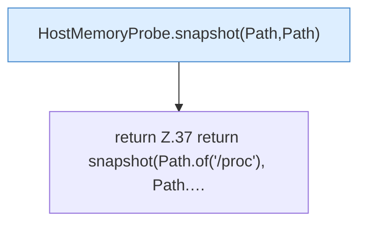

[[00 Start]] › [[Host-Betrieb]] › [[Speicher-Messung]] › [[HostMemoryProbe]] › [[HostMemoryProbe.snapshot()]]

# HostMemoryProbe.snapshot()

`HostMemoryProbe.snapshot()` [src/main/java/de/aichele/childlauncher/HostMemoryProbe.java:37–37](https://github.com/Sciddie/minecraft-serverhoster-plugin/blob/95b02b953b0b4c23673e900e021a7c3c844aa37d/src/main/java/de/aichele/childlauncher/HostMemoryProbe.java#L37-L37)



```knoten
HostMemoryProbe.snapshot(Path,Path)
  `snapshot` in `HostMemoryProbe.java`. Ruft `meminfo`, `cgroup`.
return Z.37 return snapshot(Path.of('/proc'), Path.…
  Zeile 37: Rückgabe `return snapshot(Path.of('/proc'), Path.…`.
```

- `snapshot` in `src/main/java/de/aichele/childlauncher/HostMemoryProbe.java`
