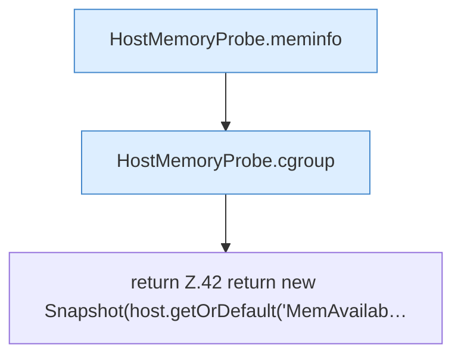

[[00 Start]] › [[Host-Betrieb]] › [[Speicher-Messung]] › [[HostMemoryProbe]] › [[HostMemoryProbe.snapshot(Path,Path)]]

# HostMemoryProbe.snapshot(Path,Path)

`HostMemoryProbe.snapshot(Path proc, Path cgroupRoot)` [src/main/java/de/aichele/childlauncher/HostMemoryProbe.java:39–45](https://github.com/Sciddie/minecraft-serverhoster-plugin/blob/95b02b953b0b4c23673e900e021a7c3c844aa37d/src/main/java/de/aichele/childlauncher/HostMemoryProbe.java#L39-L45)



```knoten
HostMemoryProbe.meminfo
  Die Messung macht hier einen einzelnen Schritt. Eine Ebene tiefer steht er genauer. `meminfo` in `HostMemoryProbe.java`.
HostMemoryProbe.cgroup
  Die Messung macht hier einen einzelnen Schritt. Eine Ebene tiefer steht er genauer. `cgroup` in `HostMemoryProbe.java`. Ruft `resolve`, `ancestors`, `number`.
return Z.42 return new Snapshot(host.getOrDefault('MemAvailab…
  Zeile 42: Rückgabe `return new Snapshot(host.getOrDefault('MemAvailab…`.
```

> [!knoten]- Was die Blöcke tun
> - **HostMemoryProbe.meminfo**: Die Messung macht hier einen einzelnen Schritt. Eine Ebene tiefer steht er genauer. `meminfo` in `HostMemoryProbe.java`.
> - **HostMemoryProbe.cgroup**: Die Messung macht hier einen einzelnen Schritt. Eine Ebene tiefer steht er genauer. `cgroup` in `HostMemoryProbe.java`. Ruft `resolve`, `ancestors`, `number`.
> - **return Z.42 return new Snapshot(host.getOrDefault('MemAvailab…**: Zeile 42: Rückgabe `return new Snapshot(host.getOrDefault('MemAvailab…`.

- Die Messung macht hier einen einzelnen Schritt. Eine Ebene tiefer steht er genauer.
- `snapshot` in `src/main/java/de/aichele/childlauncher/HostMemoryProbe.java`
