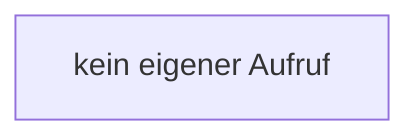

[[00 Start]] › [[Host-Betrieb]] › [[Host-Minimieren]] › [[HostMinimize]] › [[HostMinimize.Teil1]] › [[HostMinimize.HostMinimize]]

# HostMinimize.HostMinimize

`HostMinimize.HostMinimize()` [src/main/java/de/aichele/childlauncher/HostMinimize.java:30–30](https://github.com/Sciddie/minecraft-serverhoster-plugin/blob/95b02b953b0b4c23673e900e021a7c3c844aa37d/src/main/java/de/aichele/childlauncher/HostMinimize.java#L30-L30)

- `HostMinimize` in `src/main/java/de/aichele/childlauncher/HostMinimize.java`
