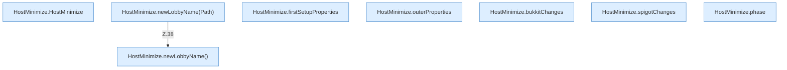

[[00 Start]] › [[Host-Betrieb]] › [[Host-Minimieren]] › [[HostMinimize]] › [[HostMinimize.Teil1]]

# HostMinimize.Teil1



```knoten
HostMinimize.HostMinimize
  Das Verkleinern des [[Glossar#Host|Host]] kümmert sich um das Verkleinern. Betrifft den Host `HostMinimize`.
HostMinimize.newLobbyName()
  Das Verkleinern des [[Glossar#Host|Host]] kümmert sich um die Wartewelt den Namen. `newLobbyName` in `HostMinimize.java`.
HostMinimize.newLobbyName(Path)
  Das Verkleinern des [[Glossar#Host|Host]] kümmert sich um die Wartewelt den Namen. `newLobbyName` in `HostMinimize.java`. Ruft `newLobbyName`.
HostMinimize.firstSetupProperties
  Das Verkleinern des [[Glossar#Host|Host]] kümmert sich um die [[Glossar#Einrichtung|Einrichtung]] die Eigenschaften. `firstSetupProperties` in `HostMinimize.java`.
HostMinimize.outerProperties
  Das Verkleinern des [[Glossar#Host|Host]] kümmert sich um die Eigenschaften. `outerProperties` in `HostMinimize.java`.
HostMinimize.bukkitChanges
  Das Verkleinern des [[Glossar#Host|Host]] macht hier einen einzelnen Schritt. Eine Ebene tiefer steht er genauer. `bukkitChanges` in `HostMinimize.java`.
HostMinimize.spigotChanges
  Das Verkleinern des [[Glossar#Host|Host]] macht hier einen einzelnen Schritt. Eine Ebene tiefer steht er genauer. `spigotChanges` in `HostMinimize.java`.
HostMinimize.phase
  Das Verkleinern des [[Glossar#Host|Host]] macht hier einen einzelnen Schritt. Eine Ebene tiefer steht er genauer. Liefert die [[Glossar#Phase|Phase]] `phase`. Ruft `worldNameSafe`.
```

> [!knoten]- Was die Blöcke tun
> - **HostMinimize.HostMinimize**: Das Verkleinern des [[Glossar#Host|Host]] kümmert sich um das Verkleinern. Betrifft den Host `HostMinimize`.
> - **HostMinimize.newLobbyName()**: Das Verkleinern des [[Glossar#Host|Host]] kümmert sich um die Wartewelt den Namen. `newLobbyName` in `HostMinimize.java`.
> - **HostMinimize.newLobbyName(Path)**: Das Verkleinern des [[Glossar#Host|Host]] kümmert sich um die Wartewelt den Namen. `newLobbyName` in `HostMinimize.java`. Ruft `newLobbyName`.
> - **HostMinimize.firstSetupProperties**: Das Verkleinern des [[Glossar#Host|Host]] kümmert sich um die [[Glossar#Einrichtung|Einrichtung]] die Eigenschaften. `firstSetupProperties` in `HostMinimize.java`.
> - **HostMinimize.outerProperties**: Das Verkleinern des [[Glossar#Host|Host]] kümmert sich um die Eigenschaften. `outerProperties` in `HostMinimize.java`.
> - **HostMinimize.bukkitChanges**: Das Verkleinern des [[Glossar#Host|Host]] macht hier einen einzelnen Schritt. Eine Ebene tiefer steht er genauer. `bukkitChanges` in `HostMinimize.java`.
> - **HostMinimize.spigotChanges**: Das Verkleinern des [[Glossar#Host|Host]] macht hier einen einzelnen Schritt. Eine Ebene tiefer steht er genauer. `spigotChanges` in `HostMinimize.java`.
> - **HostMinimize.phase**: Das Verkleinern des [[Glossar#Host|Host]] macht hier einen einzelnen Schritt. Eine Ebene tiefer steht er genauer. Liefert die [[Glossar#Phase|Phase]] `phase`. Ruft `worldNameSafe`.

- Ein weiterer Abschnitt derselben Übersicht.
