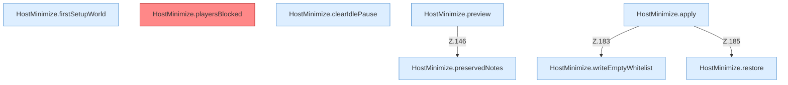

[[00 Start]] › [[Host-Betrieb]] › [[Host-Minimieren]] › [[HostMinimize]] › [[HostMinimize.Teil2]]

# HostMinimize.Teil2



```knoten
HostMinimize.firstSetupWorld
  `firstSetupWorld` in `HostMinimize.java`. Ruft `lobbyNameSafe`.
HostMinimize.playersBlocked
  Liefert die Spieler `playersBlocked`. Befund: toter Code (wahrscheinlich).
HostMinimize.clearIdlePause
  Leert `clearIdlePause`. Ruft `lobbyNameSafe`.
HostMinimize.preservedNotes
  `preservedNotes` in `HostMinimize.java`.
HostMinimize.preview
  Zeigt die Vorschau `preview`. Ruft `assertRoot`, `readProperties`, `outerProperties`.
HostMinimize.apply
  Wendet an `apply`. Ruft `assertRoot`, `assertEditable`, `update`.
HostMinimize.restore
  Stellt wieder her `restore`. Ruft `assertEditable`.
HostMinimize.writeEmptyWhitelist
  Schreibt `writeEmptyWhitelist`. Ruft `assertEditable`.
```


