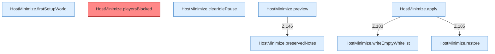

[[00 Start]] › [[Host-Betrieb]] › [[Host-Minimieren]] › [[HostMinimize]] › [[HostMinimize.Teil2]]

# HostMinimize.Teil2



```knoten
HostMinimize.firstSetupWorld
  Das Verkleinern des [[Glossar#Host|Host]] kümmert sich um die [[Glossar#Einrichtung|Einrichtung]] die [[Glossar#Spielwelt|Spielwelt]]. `firstSetupWorld` in `HostMinimize.java`. Ruft `lobbyNameSafe`.
HostMinimize.playersBlocked
  Das Verkleinern des [[Glossar#Host|Host]] macht hier einen einzelnen Schritt. Eine Ebene tiefer steht er genauer. Liefert die [[Glossar#Spieler|Spieler]] `playersBlocked`. [[Glossar#Befund|Befund]]: toter Code, wahrscheinlich. src/main/java/de/aichele/childlauncher/HostMinimize.java:102–104 nur von Tests erreicht
HostMinimize.clearIdlePause
  Das Verkleinern des [[Glossar#Host|Host]] löscht den gemerkten Stand von hier einen Schritt. Eine Ebene tiefer steht er genauer. Leert `clearIdlePause`. Ruft `lobbyNameSafe`.
HostMinimize.preservedNotes
  Das Verkleinern des [[Glossar#Host|Host]] macht hier einen einzelnen Schritt. Eine Ebene tiefer steht er genauer. `preservedNotes` in `HostMinimize.java`.
HostMinimize.preview
  Das Verkleinern des [[Glossar#Host|Host]] macht hier einen einzelnen Schritt. Eine Ebene tiefer steht er genauer. Zeigt die Vorschau `preview`. Ruft `assertRoot`, `readProperties`, `outerProperties`.
HostMinimize.apply
  Das Verkleinern des [[Glossar#Host|Host]] wendet an das. Wendet an `apply`. Ruft `assertRoot`, `assertEditable`, `update`.
HostMinimize.restore
  Das Verkleinern des [[Glossar#Host|Host]] stellt wieder her das. Stellt wieder her `restore`. Ruft `assertEditable`.
HostMinimize.writeEmptyWhitelist
  Das Verkleinern des [[Glossar#Host|Host]] schreibt hier einen Schritt. Eine Ebene tiefer steht er genauer. Schreibt `writeEmptyWhitelist`. Ruft `assertEditable`.
```

> [!knoten]- Was die Blöcke tun
> - **HostMinimize.firstSetupWorld**: Das Verkleinern des [[Glossar#Host|Host]] kümmert sich um die [[Glossar#Einrichtung|Einrichtung]] die [[Glossar#Spielwelt|Spielwelt]]. `firstSetupWorld` in `HostMinimize.java`. Ruft `lobbyNameSafe`.
> - **HostMinimize.playersBlocked**: Das Verkleinern des [[Glossar#Host|Host]] macht hier einen einzelnen Schritt. Eine Ebene tiefer steht er genauer. Liefert die [[Glossar#Spieler|Spieler]] `playersBlocked`. [[Glossar#Befund|Befund]]: toter Code, wahrscheinlich. src/main/java/de/aichele/childlauncher/HostMinimize.java:102–104 nur von Tests erreicht
> - **HostMinimize.clearIdlePause**: Das Verkleinern des [[Glossar#Host|Host]] löscht den gemerkten Stand von hier einen Schritt. Eine Ebene tiefer steht er genauer. Leert `clearIdlePause`. Ruft `lobbyNameSafe`.
> - **HostMinimize.preservedNotes**: Das Verkleinern des [[Glossar#Host|Host]] macht hier einen einzelnen Schritt. Eine Ebene tiefer steht er genauer. `preservedNotes` in `HostMinimize.java`.
> - **HostMinimize.preview**: Das Verkleinern des [[Glossar#Host|Host]] macht hier einen einzelnen Schritt. Eine Ebene tiefer steht er genauer. Zeigt die Vorschau `preview`. Ruft `assertRoot`, `readProperties`, `outerProperties`.
> - **HostMinimize.apply**: Das Verkleinern des [[Glossar#Host|Host]] wendet an das. Wendet an `apply`. Ruft `assertRoot`, `assertEditable`, `update`.
> - **HostMinimize.restore**: Das Verkleinern des [[Glossar#Host|Host]] stellt wieder her das. Stellt wieder her `restore`. Ruft `assertEditable`.
> - **HostMinimize.writeEmptyWhitelist**: Das Verkleinern des [[Glossar#Host|Host]] schreibt hier einen Schritt. Eine Ebene tiefer steht er genauer. Schreibt `writeEmptyWhitelist`. Ruft `assertEditable`.

- Ein weiterer Abschnitt derselben Übersicht.
