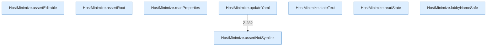

[[00 Start]] › [[Host-Betrieb]] › [[Host-Minimieren]] › [[HostMinimize]] › [[HostMinimize.Teil3]]

# HostMinimize.Teil3



```knoten
HostMinimize.assertEditable
  Das Verkleinern des [[Glossar#Host|Host]] macht hier einen einzelnen Schritt. Eine Ebene tiefer steht er genauer. Prüft `assertEditable`.
HostMinimize.assertRoot
  Das Verkleinern des [[Glossar#Host|Host]] kümmert sich um den Anfang. Prüft `assertRoot`.
HostMinimize.readProperties
  Das Verkleinern des [[Glossar#Host|Host]] liest die Eigenschaften. Liest `readProperties`.
HostMinimize.updateYaml
  Das Verkleinern des [[Glossar#Host|Host]] ändert hier einen Schritt. Eine Ebene tiefer steht er genauer. Aktualisiert `updateYaml`. Ruft `assertNotSymlink`.
HostMinimize.assertNotSymlink
  Das Verkleinern des [[Glossar#Host|Host]] macht hier einen einzelnen Schritt. Eine Ebene tiefer steht er genauer. Prüft `assertNotSymlink`.
HostMinimize.stateText
  Das Verkleinern des [[Glossar#Host|Host]] kümmert sich um den Text. Liefert den Zustand `stateText`.
HostMinimize.readState
  Das Verkleinern des [[Glossar#Host|Host]] liest den Zustand. Liest `readState`.
HostMinimize.lobbyNameSafe
  Das Verkleinern des [[Glossar#Host|Host]] kümmert sich um den Namen die erlaubte Grenze. `lobbyNameSafe` in `HostMinimize.java`.
```

> [!knoten]- Was die Blöcke tun
> - **HostMinimize.assertEditable**: Das Verkleinern des [[Glossar#Host|Host]] macht hier einen einzelnen Schritt. Eine Ebene tiefer steht er genauer. Prüft `assertEditable`.
> - **HostMinimize.assertRoot**: Das Verkleinern des [[Glossar#Host|Host]] kümmert sich um den Anfang. Prüft `assertRoot`.
> - **HostMinimize.readProperties**: Das Verkleinern des [[Glossar#Host|Host]] liest die Eigenschaften. Liest `readProperties`.
> - **HostMinimize.updateYaml**: Das Verkleinern des [[Glossar#Host|Host]] ändert hier einen Schritt. Eine Ebene tiefer steht er genauer. Aktualisiert `updateYaml`. Ruft `assertNotSymlink`.
> - **HostMinimize.assertNotSymlink**: Das Verkleinern des [[Glossar#Host|Host]] macht hier einen einzelnen Schritt. Eine Ebene tiefer steht er genauer. Prüft `assertNotSymlink`.
> - **HostMinimize.stateText**: Das Verkleinern des [[Glossar#Host|Host]] kümmert sich um den Text. Liefert den Zustand `stateText`.
> - **HostMinimize.readState**: Das Verkleinern des [[Glossar#Host|Host]] liest den Zustand. Liest `readState`.
> - **HostMinimize.lobbyNameSafe**: Das Verkleinern des [[Glossar#Host|Host]] kümmert sich um den Namen die erlaubte Grenze. `lobbyNameSafe` in `HostMinimize.java`.

- Ein weiterer Abschnitt derselben Übersicht.
