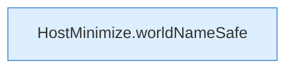

[[00 Start]] › [[Host-Betrieb]] › [[Host-Minimieren]] › [[HostMinimize]] › [[HostMinimize.Teil4]]

# HostMinimize.Teil4



```knoten
HostMinimize.worldNameSafe
  Das Verkleinern des [[Glossar#Host|Host]] kümmert sich um den Namen die erlaubte Grenze. Betrifft die Welt `worldNameSafe`.
```

> [!knoten]- Was die Blöcke tun
> - **HostMinimize.worldNameSafe**: Das Verkleinern des [[Glossar#Host|Host]] kümmert sich um den Namen die erlaubte Grenze. Betrifft die Welt `worldNameSafe`.

- Ein weiterer Abschnitt derselben Übersicht.
