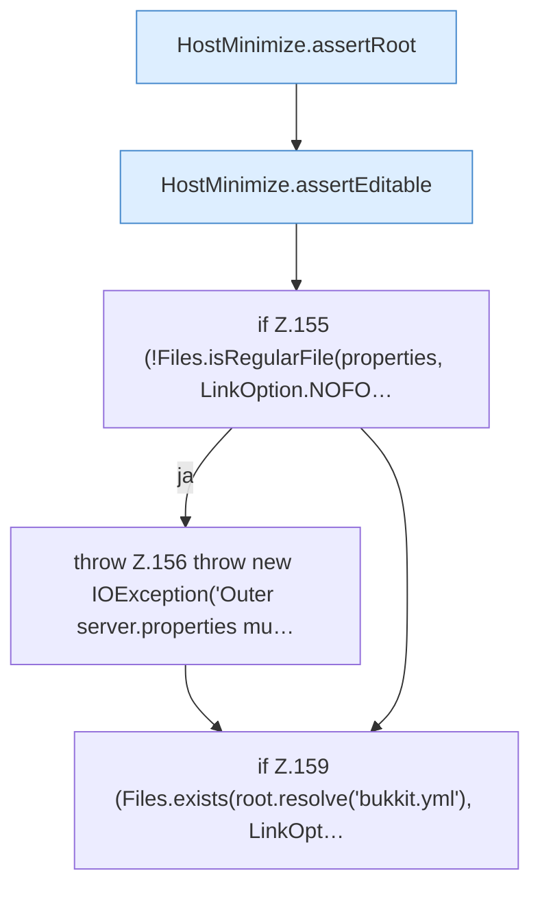

[[00 Start]] › [[Host-Betrieb]] › [[Host-Minimieren]] › [[HostMinimize]] › [[HostMinimize.Teil2]] › [[HostMinimize.apply]] › [[HostMinimize.apply.Teil1]]

# HostMinimize.apply.Teil1



```knoten
HostMinimize.assertRoot
  Das Verkleinern des [[Glossar#Host|Host]] kümmert sich um den Anfang. Prüft `assertRoot`.
HostMinimize.assertEditable
  Das Verkleinern des [[Glossar#Host|Host]] macht hier einen einzelnen Schritt. Eine Ebene tiefer steht er genauer. Prüft `assertEditable`.
if Z.155 (!Files.isRegularFile(properties, LinkOption.NOFO…
  Zeile 155: prüft `(!Files.isRegularFile(properties, LinkOption.NOFO…`.
throw Z.156 throw new IOException('Outer server.properties mu…
  Zeile 156: Abbruch `throw new IOException('Outer server.properties mu…`.
if Z.159 (Files.exists(root.resolve('bukkit.yml'), LinkOpt…
  Zeile 159: prüft `(Files.exists(root.resolve('bukkit.yml'), LinkOpt…`.
```

> [!knoten]- Was die Blöcke tun
> - **HostMinimize.assertRoot**: Das Verkleinern des [[Glossar#Host|Host]] kümmert sich um den Anfang. Prüft `assertRoot`.
> - **HostMinimize.assertEditable**: Das Verkleinern des [[Glossar#Host|Host]] macht hier einen einzelnen Schritt. Eine Ebene tiefer steht er genauer. Prüft `assertEditable`.
> - **if Z.155 (!Files.isRegularFile(properties, LinkOption.NOFO…**: Zeile 155: prüft `(!Files.isRegularFile(properties, LinkOption.NOFO…`.
> - **throw Z.156 throw new IOException('Outer server.properties mu…**: Zeile 156: Abbruch `throw new IOException('Outer server.properties mu…`.
> - **if Z.159 (Files.exists(root.resolve('bukkit.yml'), LinkOpt…**: Zeile 159: prüft `(Files.exists(root.resolve('bukkit.yml'), LinkOpt…`.

- Ein weiterer Abschnitt derselben Übersicht.
- Fortsetzung von `HostMinimize.apply`.
