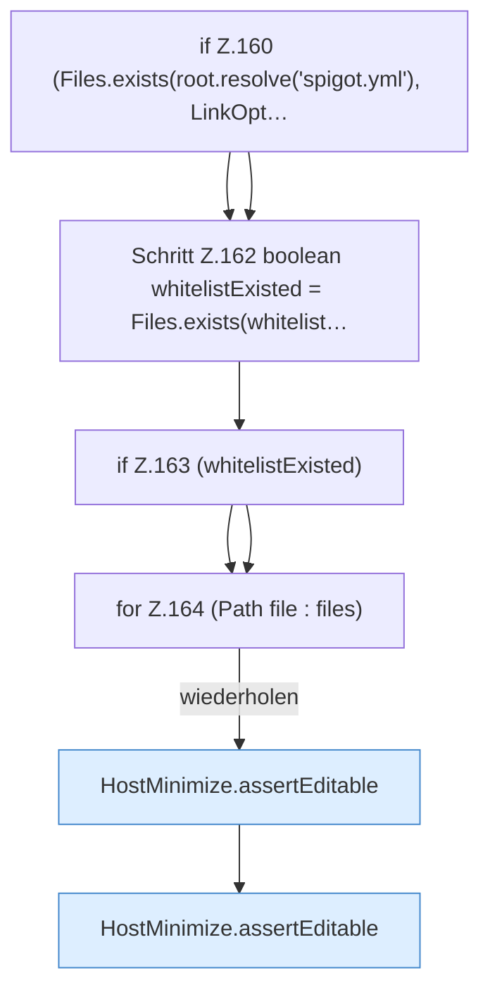

[[00 Start]] › [[Host-Betrieb]] › [[Host-Minimieren]] › [[HostMinimize]] › [[HostMinimize.Teil2]] › [[HostMinimize.apply]] › [[HostMinimize.apply.Teil2]]

# HostMinimize.apply.Teil2

- Fortsetzung von `HostMinimize.apply`, Quellreihenfolge.
